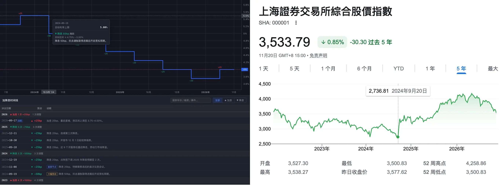

# 美联储利率阶梯图

> 天下熙熙皆为利来，天下攘攘皆为利往。
> 美联储降息我抄底，美联储加息我做空。 —— Del Wang

  
  
<i>美联储利率与上证指数趋势对比图</i>

## 免责声明

投资有风险，入市需谨慎。本项目及内容仅为信息交流与知识科普，**不构成任何投资建议、买卖操作指引、收益承诺或风险担保**。 市场存在不确定性，价格波动、政策变化与流动性风险均可能导致本金亏损。请独立判断、自主决策并自行承担风险，如需专业意见请咨询持牌金融顾问。

---

\*_数据来源：[FOMC's target federal funds rate or range, change (basis points) and level](https://www.federalreserve.gov/monetarypolicy/openmarket.htm)_
